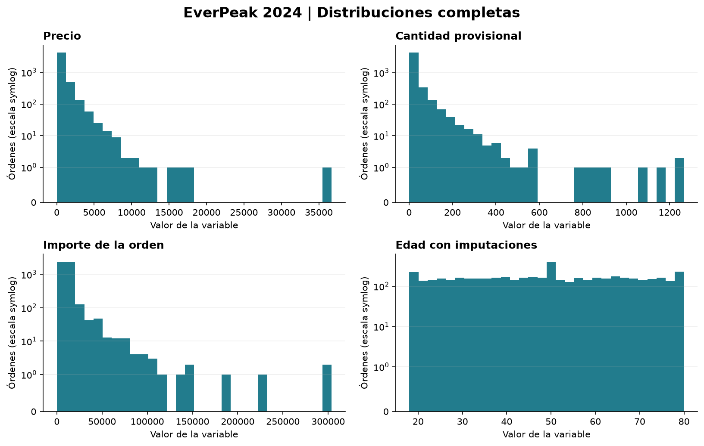

# EverPeak 2024: análisis de compras y calidad de datos

Proyecto educativo de **José Luis Ronquillo Quintanar**, desarrollado en el Sprint 7 de TripleTen con asistencia de IA.

Se revisan problemas de calidad, distribuciones, valores atípicos y reglas de segmentación. Cada fila es una orden; los resultados no equivalen a clientes únicos.

[](https://colab.research.google.com/github/jluisrq5/everpeak-analysis/blob/main/everpeak_analysis.ipynb)

## Resultados principales

- **4,985 órdenes de 2024** analizadas, a partir de 5,008 registros. Se apartaron 8 sin fecha y 15 de 2026.
- Importe medio de **10,070.99** y mediana de **10,339** unidades monetarias.
- **164 importes** señalados por IQR y **63 por Z-score**. Se conservan los extremos originales; el capado se muestra solo como sensibilidad.
- **174 edades imputadas**, identificadas con una bandera y excluidas de la clasificación por edad.
- **2,025 diferencias aritméticas** entre precio, cantidad positiva original y total. La cantidad sigue siendo provisional; requiere validar descuentos, cargos y unidades antes de usarla para inventario.



## Decisiones del análisis

El pipeline conserva el origen, delimita el periodo a 2024, normaliza categorías y registra los cambios. Reconstruye cantidades no positivas solo cuando el cociente importe/precio es entero, bajo el supuesto explícito de que no existen descuentos ni cargos adicionales. Este supuesto requiere validación comercial.

Los segmentos usan gasto y edad. Las etiquetas VIP, medio y bajo son reglas didácticas por orden, no una medición del valor de vida de cada cliente. Los datos atípicos no se eliminan automáticamente.

El total original de importes de 2024 es **50,203,903**. Limitar al percentil 99 reduce esa suma aproximadamente **3.78%**; el importe limitado no sustituye al original para reportar ingresos.

## Archivos

```text
everpeak_analysis.ipynb    Notebook con tablas, gráficos, decisiones y código
analysis.py               Pipeline para recalcular con el CSV autorizado
results_aggregate.json    Resultados agregados calculados en TripleTen
requirements.txt          Bibliotecas del análisis
reports/                  Gráficos del notebook
```

## Cómo reproducirlo

**Ver y ejecutar las tablas y gráficos:** abre el botón de Colab y ejecuta las celdas en orden. Este modo utiliza los agregados publicados. También puedes descargar el repositorio y abrir el notebook localmente.

**Recalcular desde los registros originales:** obtén `everpeak_retail.csv` mediante tu acceso autorizado al curso, colócalo en `data/` y activa `RECALCULAR = True` en el notebook. Por terminal:

```bash
pip install -r requirements.txt
python analysis.py --data data/everpeak_retail.csv --output results_aggregate.json
```

Los datos individuales del curso no están incluidos. Los cálculos sobre el origen se ejecutaron dentro de TripleTen; las tablas y gráficos de este notebook se ejecutaron localmente sobre los agregados. Los resultados del pipeline propio pueden diferir de `everpeak_clean.csv`, porque se delimita 2024 y se documentan reglas adicionales.

## Fuentes y alcance

Dataset educativo y lecciones del Sprint 7 de TripleTen, consultados el 31 de octubre de 2026. El repositorio contiene código propio y resultados agregados, sin videos, transcripciones completas ni registros individuales. No se atribuye una moneda al dataset.

Referencias: [pandas](https://pandas.pydata.org/docs/reference/api/pandas.Series.value_counts.html), [histogramas en Matplotlib](https://matplotlib.org/stable/api/_as_gen/matplotlib.pyplot.hist.html), [boxplots en Matplotlib](https://matplotlib.org/stable/api/_as_gen/matplotlib.pyplot.boxplot.html).
